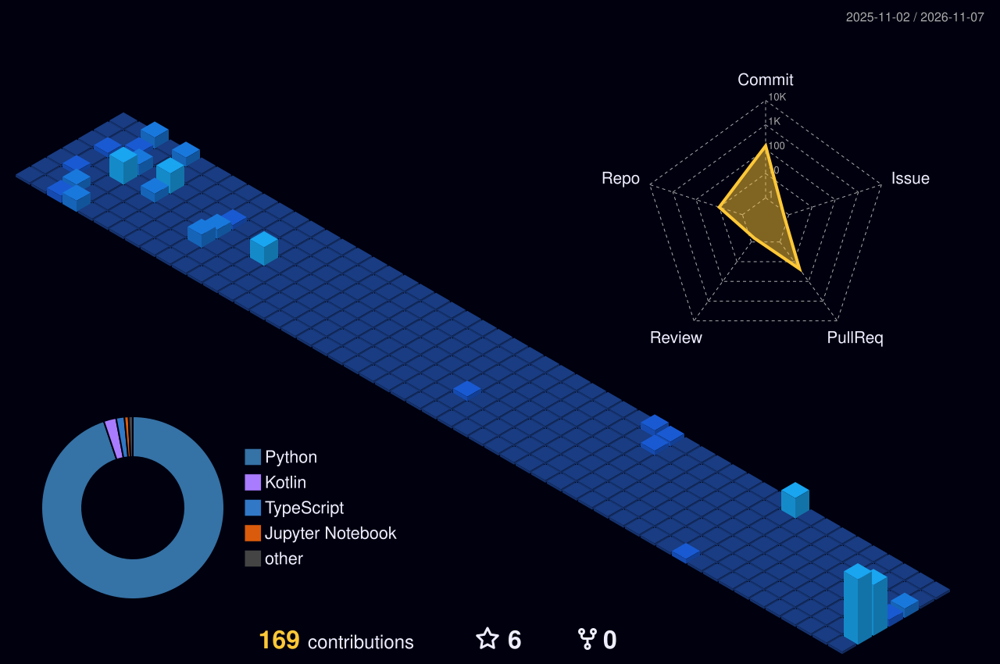

<div align="center">

<picture>
  <source media="(prefers-color-scheme: dark)" srcset="https://raw.githubusercontent.com/vfranco00/vfranco00/main/assets/header-dark.svg"/>
  <source media="(prefers-color-scheme: light)" srcset="https://raw.githubusercontent.com/vfranco00/vfranco00/main/assets/header-light.svg"/>
  
</picture>
<br/><br/>


<a href="https://www.linkedin.com/in/ofrancodev/">
  
</a>
<a href="https://github.com/vfranco00">
  
</a>
<a href="mailto:victorfranco02@outlook.com">
  
</a>

</div>

---

## 💻 whoami

```console
franco@dev:~$ cat about.json
{
  "nome":       "Victor Franco",
  "cargo":      "Full Stack Developer",
  "local":      "Ouro Branco, MG — Brasil",
  "formacao":   "Sistemas de Informação @ IFMG",
  "idiomas":    ["pt-BR (nativo)", "en (C2)"],
  "stack_atual":["Next.js", "TypeScript", "Supabase", "Tailwind CSS"],
  "background": ["Python", "Dados", "Automação", "AWS", "APIs"],
  "ia":         ["Claude Code", "MCP", "LLMs", "Prompt Engineering", "RAG"]
}

franco@dev:~$ ./journey.sh
→ Gerdau & Vallourec ....... APIs robustas, pipelines ETL, sistemas de dados
→ hoje .................... web moderna, do pixel perfeito à query otimizada

franco@dev:~$ claude "implemente a próxima feature"
✓ planejada, implementada, testada e com PR aberto

franco@dev:~$ echo $PHILOSOPHY
"Código limpo é poesia. Arquitetura sólida é a rima."

franco@dev:~$ _
```

Sou desenvolvedor Full Stack com paixão por criar aplicações web que unem design
impecável, performance e arquitetura sólida. Minha jornada começou no mundo de Dados
e Automação em grandes indústrias, e hoje levo essa mentalidade de engenharia para o
ecossistema web moderno.

---

## 🤖 IA & LLMs no Desenvolvimento

IA não é enfeite no meu fluxo: é parte da engenharia. Uso **Claude Code** todos os dias,
conecto ferramentas reais via **MCP** e trato **prompts** como código — versionados,
testados e revisados.

<div align="center">

<picture>
  <source media="(prefers-color-scheme: dark)" srcset="https://raw.githubusercontent.com/vfranco00/vfranco00/main/assets/ai-dark.svg"/>
  <source media="(prefers-color-scheme: light)" srcset="https://raw.githubusercontent.com/vfranco00/vfranco00/main/assets/ai-light.svg"/>
  
</picture>

<p>
  
  
  
  
  
  
</p>

</div>

<table>
<tr>
<td width="50%" valign="top">

**⚡ Claude Code no dia a dia**

- **Arquitetura de features** — desenho de módulos e fronteiras de domínio
- **Refatoração** — eliminação de dívida técnica com contexto do repo inteiro
- **Testes** — cobertura de edge cases e caminhos de falha
- **Documentação** — ADRs, contratos de API e READMEs
- **Code review** — segunda opinião antes de cada merge

</td>
<td width="50%" valign="top">

**🔌 MCP — Model Context Protocol**

- Conecto o agente a **Supabase**, **GitHub** e APIs internas
- O modelo consulta schema, abre PRs e lê issues **com contexto real**
- Servidores MCP próprios para expor ferramentas do projeto
- Menos copiar e colar, mais automação com segurança

</td>
</tr>
<tr>
<td width="50%" valign="top">

**🧠 LLMs em produto**

- **[NutriAgent](https://github.com/vfranco00/Nutri_Agent)** — planejamento nutricional com **Gemini**
- Saídas estruturadas (JSON) validadas antes de chegar ao usuário
- Pipelines com **RAG** e agentes com *tool use*
- Atenção a custo por token, latência e *fallbacks*

</td>
<td width="50%" valign="top">

**✍️ Prompts como código**

- System prompts versionados junto com o repositório
- Few-shot e exemplos negativos para reduzir alucinação
- Avaliação com casos de teste antes de trocar modelo ou prompt
- `CLAUDE.md`, skills e hooks para padronizar o agente no time

</td>
</tr>
</table>

> *"Eu sou o arquiteto. Claude é o construtor."*
> A IA acelera a entrega; pensamento crítico e decisão arquitetural continuam sendo meus.

---

## 🛠 Tech Stack

**Front-end**

<p>
  
  
  
  
  
  
  
</p>

**Back-end & Banco de Dados**

<p>
  
  
  
  
  
  
</p>

**DevOps, Cloud & Ferramentas**

<p>
  
  
  
  
  
  
</p>

---

## 📊 GitHub Analytics

<div align="center">

<picture>
  <source media="(prefers-color-scheme: dark)" srcset="https://raw.githubusercontent.com/vfranco00/vfranco00/output/stats-dark.svg"/>
  <source media="(prefers-color-scheme: light)" srcset="https://raw.githubusercontent.com/vfranco00/vfranco00/output/stats-light.svg"/>
  
</picture>
<picture>
  <source media="(prefers-color-scheme: dark)" srcset="https://raw.githubusercontent.com/vfranco00/vfranco00/output/langs-dark.svg"/>
  <source media="(prefers-color-scheme: light)" srcset="https://raw.githubusercontent.com/vfranco00/vfranco00/output/langs-light.svg"/>
  
</picture>


<sub>Cards de estatísticas e linguagens gerados diariamente por <a href=".github/workflows/snake.yml">GitHub Actions</a> direto da API do GitHub — sem serviços de terceiros.</sub>

</div>

## 🐍 Contribuições

O snake abaixo é gerado diariamente por GitHub Actions e percorre minha grade de
contribuições. Alterna sozinho entre tema claro e escuro.

<div align="center">

<picture>
  <source media="(prefers-color-scheme: dark)" srcset="https://raw.githubusercontent.com/vfranco00/vfranco00/output/snake-dark.svg"/>
  <source media="(prefers-color-scheme: light)" srcset="https://raw.githubusercontent.com/vfranco00/vfranco00/output/snake-light.svg"/>
  
</picture>

</div>

---

## 🧊 Contribuições em 3D

<div align="center">

<picture>
  <source media="(prefers-color-scheme: dark)" srcset="https://raw.githubusercontent.com/vfranco00/vfranco00/output/profile-night-view.svg"/>
  <source media="(prefers-color-scheme: light)" srcset="https://raw.githubusercontent.com/vfranco00/vfranco00/output/profile-green-animate.svg"/>
  
</picture>

</div>

---

## 🚀 Projetos em Destaque

<div align="center">

<a href="https://github.com/vfranco00/Nutri_Agent">
<picture>
  <source media="(prefers-color-scheme: dark)" srcset="https://raw.githubusercontent.com/vfranco00/vfranco00/output/project-Nutri_Agent-dark.svg"/>
  <source media="(prefers-color-scheme: light)" srcset="https://raw.githubusercontent.com/vfranco00/vfranco00/output/project-Nutri_Agent-light.svg"/>
  
</picture>
</a>
<a href="https://github.com/vfranco00/DataCost-Governance">
<picture>
  <source media="(prefers-color-scheme: dark)" srcset="https://raw.githubusercontent.com/vfranco00/vfranco00/output/project-DataCost-Governance-dark.svg"/>
  <source media="(prefers-color-scheme: light)" srcset="https://raw.githubusercontent.com/vfranco00/vfranco00/output/project-DataCost-Governance-light.svg"/>
  
</picture>
</a>
<br/>
<a href="https://github.com/vfranco00/Detecao-de-Tumores-Cerebrais-IA">
<picture>
  <source media="(prefers-color-scheme: dark)" srcset="https://raw.githubusercontent.com/vfranco00/vfranco00/output/project-Detecao-de-Tumores-Cerebrais-IA-dark.svg"/>
  <source media="(prefers-color-scheme: light)" srcset="https://raw.githubusercontent.com/vfranco00/vfranco00/output/project-Detecao-de-Tumores-Cerebrais-IA-light.svg"/>
  
</picture>
</a>
<a href="https://github.com/vfranco00/NutriPlanner">
<picture>
  <source media="(prefers-color-scheme: dark)" srcset="https://raw.githubusercontent.com/vfranco00/vfranco00/output/project-NutriPlanner-dark.svg"/>
  <source media="(prefers-color-scheme: light)" srcset="https://raw.githubusercontent.com/vfranco00/vfranco00/output/project-NutriPlanner-light.svg"/>
  
</picture>
</a>

<sub>Descrição, linguagem, stars e última atualização lidas da API do GitHub todo dia.</sub>

</div>

---

## 🌱 Em Constante Evolução

- Estudando arquitetura de **micro-frontends** e **serverless**
- Experimentando integrações entre **Supabase** e **edge functions**
- Meta: contribuir mais com projetos **open-source** da comunidade TS/Next.js

---

<div align="center">


**"Código limpo, arquitetura sólida, experiência fluida."**

</div>
